# 🏦 SPPA Core Banking Database System (`sppa_bank_db`)
> **DBMS Capstone Project — Production-Ready Relational Database Design, Implementation, and Empirical Verification**

---

## 📌 Executive Summary

The **SPPA Bank Database System** (`sppa_bank_db`) is a robust, normalized relational database backend engineered for high-integrity financial operations. It is designed around real-world commercial banking workflows, encompassing customer onboarding (KYC), account lifecycle management, inter-branch multi-currency accounts, lending and amortization schedules, double-entry transactional accounting, and automated regulatory reporting.

### 🌟 Key Highlights
* **Strict Relational Normalization:** 3NF/BCNF compliance eliminating update, insertion, and deletion anomalies.
* **Declarative Data Integrity:** Enforces multi-table constraints, unique indexes, and domain-level `CHECK` clauses (non-negative balances, positive transaction amounts).
* **Enterprise Security & Auditability:** Role-Based Access Control (RBAC via DCL) for compliance auditors and atomic transaction controls (TCL) ensuring ACID properties during transfers.
* **Full Execution Verification:** Includes documented execution proofs across MySQL Workbench 8.0 CE validating every DDL, DML, view, trigger, and analytical query.

---

## 🏗️ Entity-Relationship (ER) Architecture

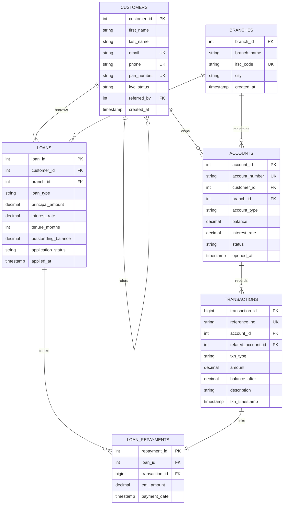

---

## 🗄️ Database Schema & Relational Specifications

The schema consists of 6 interconnected tables structured to preserve referential consistency:

| Table | Primary Key | Foreign Keys | Key Constraints & Integrity Rules |
| :--- | :--- | :--- | :--- |
| **`branches`** | `branch_id` (Auto) | *None* | `ifsc_code` UNIQUE (11 alphanumeric), `city` NOT NULL |
| **`customers`** | `customer_id` (Auto) | `referred_by` ➔ `customers(customer_id)` | UNIQUE (`email`, `phone`, `pan_number`), `kyc_status` ENUM(`PENDING`, `VERIFIED`, `REJECTED`), `ON DELETE SET NULL` on referral |
| **`accounts`** | `account_id` (Auto) | `customer_id` ➔ `customers`<br>`branch_id` ➔ `branches` | `account_number` UNIQUE, `CHECK (balance >= 0.00)`, `status` ENUM(`ACTIVE`, `FROZEN`, `CLOSED`), `ON DELETE RESTRICT` |
| **`loans`** | `loan_id` (Auto) | `customer_id` ➔ `customers`<br>`branch_id` ➔ `branches` | `CHECK (principal_amount > 0)`, `CHECK (tenure_months > 0)`, `CHECK (outstanding_balance >= 0)`, `ON DELETE RESTRICT` |
| **`transactions`**| `transaction_id` (Auto) | `account_id` ➔ `accounts`<br>`related_account_id` ➔ `accounts` | `reference_no` UNIQUE, `CHECK (amount > 0)`, `txn_type` ENUM(`DEPOSIT`, `WITHDRAWAL`, `TRANSFER_IN`, `TRANSFER_OUT`, `LOAN_EMI`) |
| **`loan_repayments`** | `repayment_id` (Auto) | `loan_id` ➔ `loans`<br>`transaction_id` ➔ `transactions` | `transaction_id` UNIQUE (1:1 ledger link), `CHECK (emi_amount > 0)`, `ON DELETE RESTRICT` |

---

## 🚀 Execution & Setup Guide

### Prerequisites
* **RDBMS Engine:** MySQL Server 8.0 or higher
* **Administration Tool:** MySQL Workbench 8.0 CE or MySQL Command Line Client (`mysql`)

### Step-by-Step Pipeline
Run the SQL scripts in strict numerical sequence to satisfy foreign key dependencies:

```bash
# 1. Connect to MySQL Server
mysql -u root -p

# 2. Execute files sequentially
mysql> SOURCE create_tables.sql;
mysql> SOURCE insert_sample_data.sql;
mysql> SOURCE views_and_security.sql;
mysql> SOURCE project_queries.sql;
```

---

## 📑 Detailed Script Walkthrough & Execution Proofs

---

### Step 1: Database Schema & Table Creation ([`create_tables.sql`](./create_tables.sql))

Defines the normalized DDL tables, data types, domains, primary keys, foreign key references, and integrity check constraints.

```sql
SOURCE create_tables.sql;
SHOW TABLES;
```

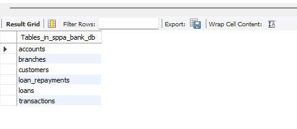

* **Execution Proof:** Displays all 6 relational tables successfully created in the `sppa_bank_db` schema (`accounts`, `branches`, `customers`, `loan_repayments`, `loans`, `transactions`).
* **Key Verification:** Validates that primary/foreign key definitions and check constraints compiled cleanly with zero syntax or engine errors.

---

### Step 2: Realistic Sample Data Ingestion ([`insert_sample_data.sql`](./insert_sample_data.sql))

Seeds the database with structured mock banking data across multiple quarters (September – November 2026), including branch networks, customers across KYC tiers, multi-type bank accounts, loan commitments, and chronological transaction records.

```sql
SOURCE insert_sample_data.sql;
SELECT * FROM branches;
```

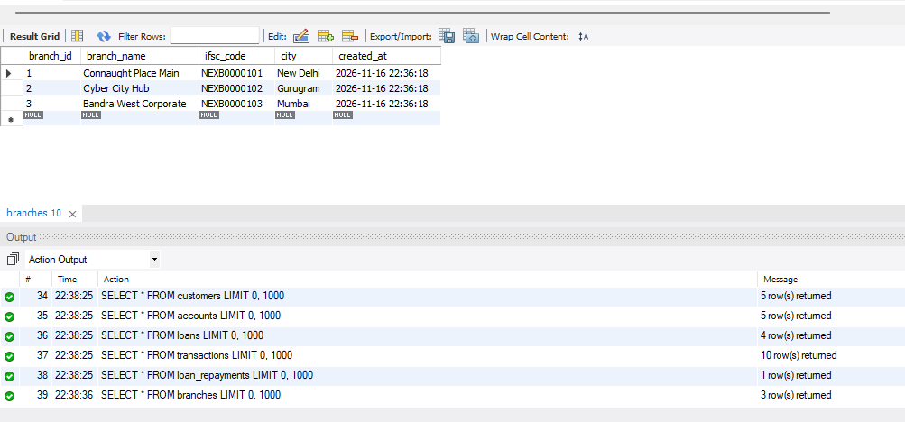

* **Execution Proof:** The Result Grid confirms the active branches, while the **Action Output** log verifies complete row insertion across all tables: `customers` (5 rows), `accounts` (5 rows), `loans` (4 rows), `transactions` (10 rows), `loan_repayments` (1 row), and `branches` (3 rows).
* **Key Verification:** Confirms valid foreign key references and default value population upon insert.

---

### Step 3: Indexes, Views, Security & TCL ([`views_and_security.sql`](./views_and_security.sql))

Implements database performance indexing, analytical reporting abstractions (views), user security roles (DCL), and ACID-compliant transaction control (TCL).

#### 3.1 Composite B-Tree Indexes
Created on high-frequency search vectors to improve query planner execution speed.

```sql
SHOW INDEX FROM transactions;
SHOW INDEX FROM customers;
SHOW INDEX FROM loans;
```

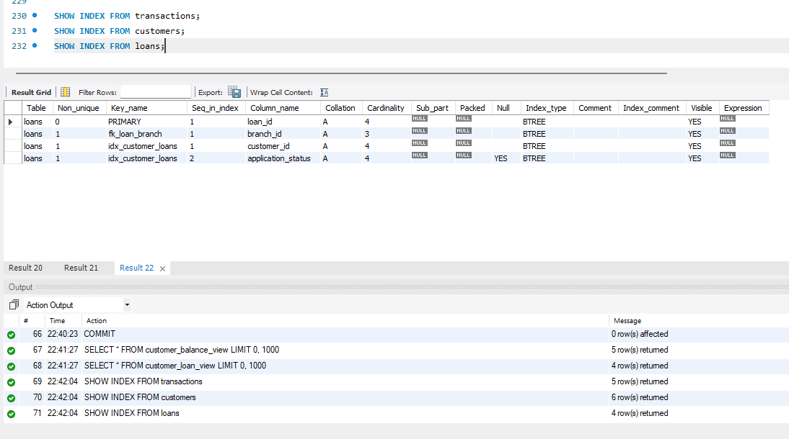

* **Execution Proof:** Demonstrates active B-Tree indexing on the `loans` table, displaying the primary key, foreign key (`fk_loan_branch`), and composite index (`idx_customer_loans` on `customer_id` + `application_status`).
* **Key Verification:** The Action Output confirms indexes on `transactions`, `customers`, and `loans` are compiled and active.

---

#### 3.2 Reporting Views & TCL Atomic Money Transfer
Exposes simplified reporting projections (`customer_balance_view`, `customer_loan_view`) and executes a two-phase transfer wrapped inside a safe transaction block.

```sql
START TRANSACTION;
UPDATE accounts SET balance = balance - 2000.00 WHERE account_id = 1 AND balance >= 2000.00;
UPDATE accounts SET balance = balance + 2000.00 WHERE account_id = 3;
INSERT INTO transactions (reference_no, account_id, related_account_id, txn_type, amount, balance_after, description)
SELECT 'REF-TRANSFER-01', 1, 3, 'TRANSFER_OUT', 2000.00, balance, 'Safe TCL Transfer' FROM accounts WHERE account_id = 1;
INSERT INTO transactions (reference_no, account_id, related_account_id, txn_type, amount, balance_after, description)
SELECT 'REF-TRANSFER-02', 3, 1, 'TRANSFER_IN', 2000.00, balance, 'Safe TCL Transfer' FROM accounts WHERE account_id = 3;
COMMIT;

SELECT * FROM customer_loan_view;
```

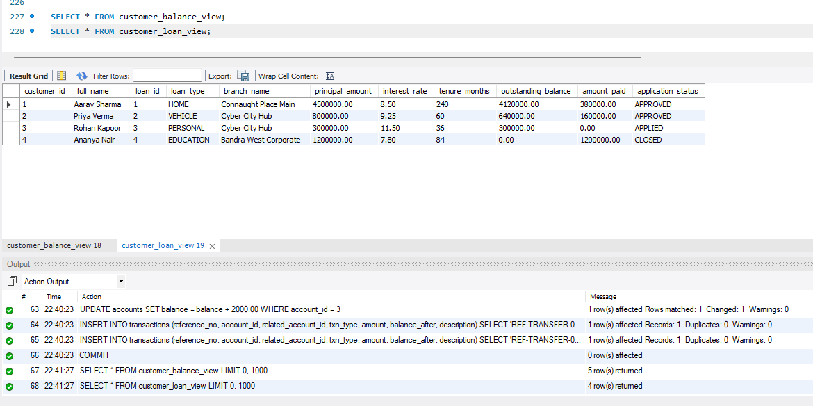

* **Execution Proof:** Displays the `customer_loan_view` showing principal, interest rate, outstanding debt, and amount paid per customer.
* **Key Verification:** The Action Output confirms atomic balance updates on accounts, dual-sided transaction ledger logging (`REF-TRANSFER-01` & `02`), and a successful `COMMIT`.

---

#### 3.3 Role-Based Security & DCL Privileges (`bank_auditor`)
Demonstrates database security administration by provisioning a least-privilege auditor account.

```sql
SHOW GRANTS FOR 'bank_auditor'@'localhost';
```

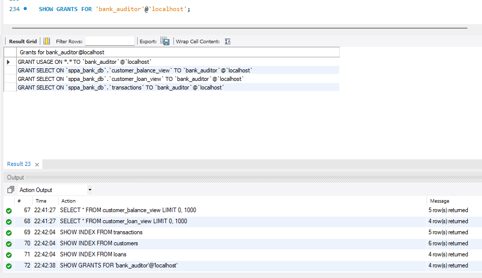

* **Execution Proof:** Validates that user `'bank_auditor'@'localhost'` holds explicit read-only (`SELECT`) privileges restricted to `customer_balance_view`, `customer_loan_view`, and `transactions`.
* **Key Verification:** Confirms granular access control preventing unauthorized direct access to raw customer PII or account alteration tables.

---

### Step 4: Analytical & Business Queries ([`project_queries.sql`](./project_queries.sql))

Executes advanced relational operations demonstrating multi-table joins, subqueries, set operations, window functions/CTEs, and programmability.

---

#### 4.1 Multi-Table `INNER JOIN` — Detailed Account Statement
Synthesizes relational data across 4 normalized tables (`transactions`, `accounts`, `customers`, `branches`) to construct a formal statement for account `100100001001`.

```sql
SELECT 
    t.reference_no, t.txn_timestamp, a.account_number,
    CONCAT(c.first_name, ' ', c.last_name) AS customer_name,
    b.branch_name, t.txn_type, t.amount, t.balance_after, t.description
FROM transactions t
INNER JOIN accounts a ON t.account_id = a.account_id
INNER JOIN customers c ON a.customer_id = c.customer_id
INNER JOIN branches b ON a.branch_id = b.branch_id
WHERE a.account_number = '100100001001'
ORDER BY t.txn_timestamp DESC;
```

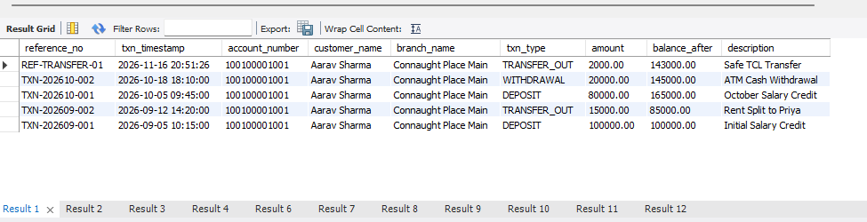

* **Execution Proof:** Seamlessly joins transaction amounts, running post-transaction balances, customer names, and branch metadata.
* **Key Verification:** Validates referential integrity and shows the recent `Safe TCL Transfer` (`REF-TRANSFER-01`) alongside historical ATM withdrawals and salary credits.

---

#### 4.2 `LEFT OUTER JOIN` — Complete Customer Roster & KYC Status
Audits all registered customers, including prospective customers who do not yet have an opened bank account.

```sql
SELECT 
    c.customer_id,
    CONCAT(c.first_name, ' ', c.last_name) AS customer_name,
    c.kyc_status,
    a.account_number,
    COALESCE(a.balance, 0.00) AS balance
FROM customers c
LEFT JOIN accounts a ON c.customer_id = a.customer_id;
```

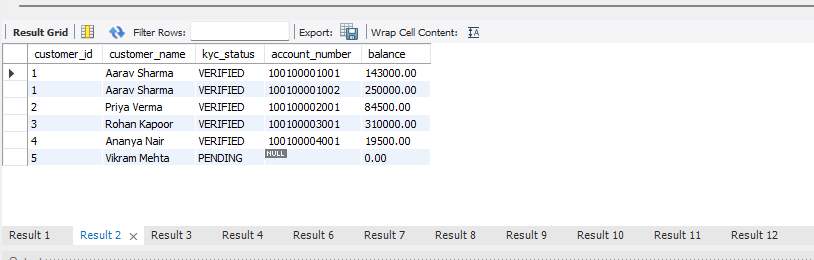

* **Execution Proof:** Preserves all customer records regardless of whether corresponding entries exist in the `accounts` table.
* **Key Verification:** Customer Vikram Mehta (`kyc_status: PENDING`) is cleanly retained with a `NULL` account number and a default `0.00` balance via `COALESCE`.

---

#### 4.3 `RIGHT OUTER JOIN` — Branch Inventory & Portfolio Distribution
Maps every physical bank branch office against its managed accounts to ensure full branch inventory coverage.

```sql
SELECT 
    b.branch_name,
    b.city,
    a.account_number,
    a.account_type,
    a.balance
FROM accounts a
RIGHT JOIN branches b ON a.branch_id = b.branch_id;
```

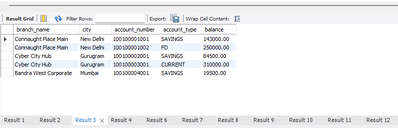

* **Execution Proof:** Guarantees all regional branch offices (Connaught Place, Cyber City, Bandra West) are displayed alongside their associated account portfolio.
* **Key Verification:** Confirms proper relationship mapping across branch entities and displays account classifications (`SAVINGS`, `FD`, `CURRENT`).

---

#### 4.4 `SELF JOIN` — Customer Referral Hierarchy
Traverses the recursive unary relationship on `referred_by` to analyze customer growth networks.

```sql
SELECT 
    c.customer_id,
    CONCAT(c.first_name, ' ', c.last_name) AS customer_name,
    CONCAT(r.first_name, ' ', r.last_name) AS referred_by_name
FROM customers c
LEFT JOIN customers r ON c.referred_by = r.customer_id;
```

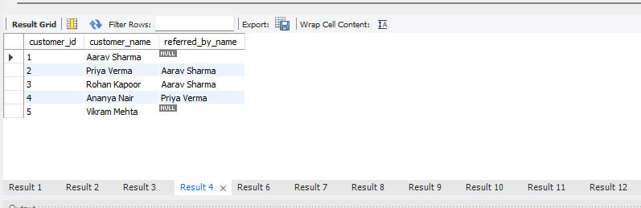

* **Execution Proof:** Queries the `customers` table against itself via alias mapping `c` (referee) and `r` (referrer).
* **Key Verification:** Displays that Aarav Sharma referred Priya Verma and Rohan Kapoor, while Priya Verma referred Ananya Nair; unreferred users correctly output `NULL`.

---

#### 4.5 Correlated Subquery — Latest Transaction per Account
Dynamically isolates the single most recent transaction record for each account using an inner correlated subquery.

```sql
SELECT 
    a.account_number,
    t.reference_no,
    t.txn_type,
    t.amount,
    t.txn_timestamp
FROM accounts a
JOIN transactions t ON a.account_id = t.account_id
WHERE t.txn_timestamp = (
    SELECT MAX(t2.txn_timestamp)
    FROM transactions t2
    WHERE t2.account_id = a.account_id
);
```

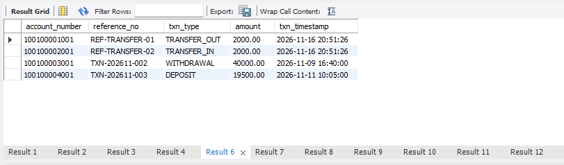

* **Execution Proof:** Evaluates each outer account record against the inner maximum timestamp for that specific `account_id`.
* **Key Verification:** Successfully returns exactly one latest transaction per account, proving the correlated subquery's filtering precision.

---

#### 4.6 Common Table Expression (CTE) & Window Functions — Financial Analytics
Calculates monthly debits/credits, running net balance, and partitioned customer deposit rankings using `SUM() OVER ()` and `RANK() OVER ()`.

```sql
WITH monthly_activity AS (
    SELECT 
        a.account_number,
        CONCAT(c.first_name, ' ', c.last_name) AS customer_name,
        DATE_FORMAT(t.txn_timestamp, '%Y-%m') AS month_year,
        SUM(CASE WHEN t.txn_type IN ('DEPOSIT', 'TRANSFER_IN') THEN t.amount ELSE 0 END) AS total_credits,
        SUM(CASE WHEN t.txn_type IN ('WITHDRAWAL', 'TRANSFER_OUT', 'LOAN_EMI') THEN t.amount ELSE 0 END) AS total_debits
    FROM transactions t
    JOIN accounts a ON t.account_id = a.account_id
    JOIN customers c ON a.customer_id = c.customer_id
    GROUP BY a.account_number, customer_name, month_year
)
SELECT 
    account_number,
    customer_name,
    month_year,
    total_credits,
    total_debits,
    (total_credits - total_debits) AS net_monthly_change,
    SUM(total_credits - total_debits) OVER (
        PARTITION BY account_number ORDER BY month_year
    ) AS running_net_total,
    RANK() OVER (
        PARTITION BY month_year ORDER BY total_credits DESC
    ) AS monthly_deposit_rank
FROM monthly_activity
ORDER BY month_year DESC, monthly_deposit_rank ASC;
```

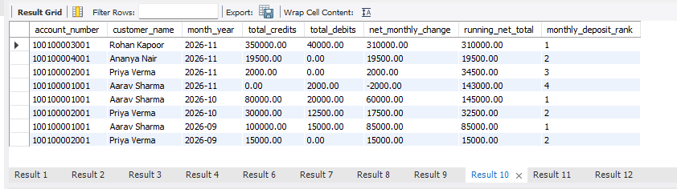

* **Execution Proof:** Demonstrates modern SQL analytical capabilities combining a modular CTE with partitioned window functions.
* **Key Verification:** Verifies cumulative running totals (`running_net_total`) and dynamically ranks customers by monthly deposits (`monthly_deposit_rank`) without collapsing granular row details.

---

#### 4.7 Stored Procedure Invocation & MySQL Workbench Action Log
Tests the compiled stored procedure `get_account_statement` and presents the complete Workbench Action Output log proving clean script execution.

```sql
CALL get_account_statement('100100001001');
```

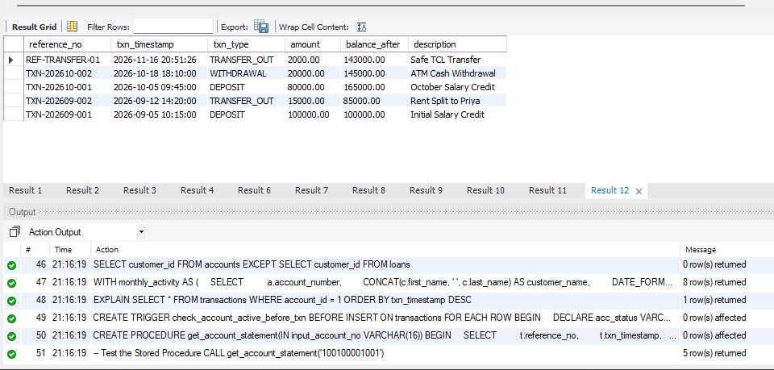

* **Execution Proof:** Result grid displays the 5 statement rows returned by the parameterized stored procedure `get_account_statement('100100001001')`.
* **Key Verification:** The bottom **Action Output** panel displays all green checkmarks, confirming zero syntax errors across Set Operations (`EXCEPT`), `EXPLAIN` query plans, Trigger creation (`check_account_active_before_txn`), and Procedure invocation.

---

## 🛡️ ACID Compliance & Integrity Guarantees

* **Atomicity:** Two-phase money transfers guarantee that both the debit from the source account and credit to the destination account succeed together, or roll back entirely.
* **Consistency:** Managed through `CHECK (balance >= 0.00)` and `CHECK (amount > 0)`, preventing negative overdrafts or illicit zero-sum transactions.
* **Isolation:** Default `REPEATABLE READ` transaction isolation level prevents dirty and non-repeatable reads during concurrent operations.
* **Durability:** Committed transactions are flushed to the InnoDB write-ahead redo log (`ib_logfile`), ensuring crash recovery.
