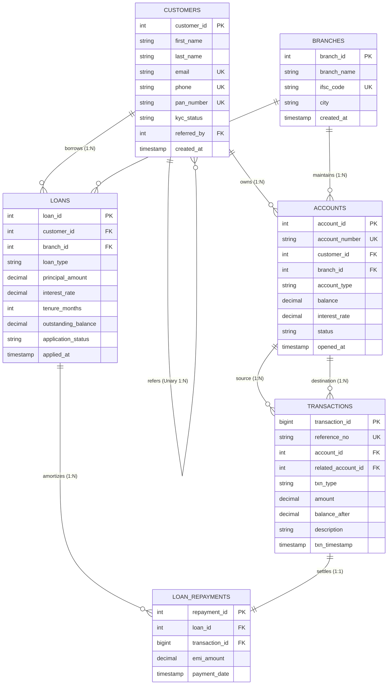

# 📊 Entity-Relationship (ER) Diagram & Conceptual Schema
> **SPPA Core Banking System (`sppa_bank_db`)**

---

## 1. Overview & Architecture

The **SPPA Bank Database** is modeled as an enterprise-grade commercial banking database system. It captures the essential entities of modern retail banking: physical branch infrastructure, customer identities with KYC verification, multi-currency savings and current accounts, loan facilities, and double-entry transaction ledgers.

---

## 2. Visual ER Diagram (Crow's Foot Notation)

---

## 3. Entity Classification & Attribute Breakdown

### 3.1 `BRANCHES` (Strong Entity)
Represents the physical branch offices of the banking network.
* **`branch_id`** (`INT`, PK, Auto Increment): Unique surrogate identifier for each branch.
* **`branch_name`** (`VARCHAR(100)`, NOT NULL): Official branch designation.
* **`ifsc_code`** (`VARCHAR(11)`, NOT NULL, UNIQUE): 11-character Indian Financial System Code.
* **`city`** (`VARCHAR(50)`, NOT NULL): City where the branch operates.
* **`created_at`** (`TIMESTAMP`): Timestamp of branch provisioning.

### 3.2 `CUSTOMERS` (Strong Entity)
Represents registered bank customers undergoing KYC compliance.
* **`customer_id`** (`INT`, PK, Auto Increment): Unique customer identifier.
* **`first_name`**, **`last_name`** (`VARCHAR(50)`, NOT NULL): Legal identity attributes.
* **`email`** (`VARCHAR(100)`, NOT NULL, UNIQUE): Electronic mail address.
* **`phone`** (`VARCHAR(15)`, NOT NULL, UNIQUE): Mobile phone number.
* **`pan_number`** (`VARCHAR(10)`, NOT NULL, UNIQUE): Tax identification code.
* **`kyc_status`** (`ENUM('PENDING', 'VERIFIED', 'REJECTED')`): Regulatory compliance status.
* **`referred_by`** (`INT`, FK, NULL): Unary recursive reference to `customers(customer_id)`.
* **`created_at`** (`TIMESTAMP`): Registration timestamp.

### 3.3 `ACCOUNTS` (Associative Entity)
Represents financial deposit and current accounts owned by customers at a specific branch.
* **`account_id`** (`INT`, PK, Auto Increment): Internal account identifier.
* **`account_number`** (`VARCHAR(16)`, NOT NULL, UNIQUE): 16-digit public bank account number.
* **`customer_id`** (`INT`, FK, NOT NULL): Primary account holder.
* **`branch_id`** (`INT`, FK, NOT NULL): Home branch managing this account.
* **`account_type`** (`ENUM('SAVINGS', 'CURRENT', 'FD')`): Classification of the account product.
* **`balance`** (`DECIMAL(15,2)`, NOT NULL, DEFAULT 0.00): Current book balance.
* **`interest_rate`** (`DECIMAL(4,2)`, NOT NULL): Applicable annual percentage rate.
* **`status`** (`ENUM('ACTIVE', 'FROZEN', 'CLOSED')`): Operational account lifecycle status.
* **`opened_at`** (`TIMESTAMP`): Account creation date and time.

### 3.4 `LOANS` (Entity)
Represents lending contracts sanctioned by branches to eligible customers.
* **`loan_id`** (`INT`, PK, Auto Increment): Unique loan agreement identifier.
* **`customer_id`** (`INT`, FK, NOT NULL): Primary borrower.
* **`branch_id`** (`INT`, FK, NOT NULL): Sanctioning branch office.
* **`loan_type`** (`ENUM('HOME', 'PERSONAL', 'EDUCATION', 'VEHICLE')`): Classification of credit product.
* **`principal_amount`** (`DECIMAL(15,2)`, NOT NULL): Total borrowed principal.
* **`interest_rate`** (`DECIMAL(4,2)`, NOT NULL): Annual percentage interest rate.
* **`tenure_months`** (`INT`, NOT NULL): Repayment horizon in months.
* **`outstanding_balance`** (`DECIMAL(15,2)`, NOT NULL): Principal remaining unpaid.
* **`application_status`** (`ENUM('APPLIED', 'APPROVED', 'REJECTED', 'CLOSED')`): Approval lifecycle state.
* **`applied_at`** (`TIMESTAMP`): Loan origination timestamp.

### 3.5 `TRANSACTIONS` (Weak / Dependent Entity)
Append-only double-entry transactional ledger recording all cash flows.
* **`transaction_id`** (`BIGINT`, PK, Auto Increment): Unique ledger sequence number.
* **`reference_no`** (`VARCHAR(36)`, NOT NULL, UNIQUE): Unique external transaction reference.
* **`account_id`** (`INT`, FK, NOT NULL): Primary account debited/credited.
* **`related_account_id`** (`INT`, FK, NULL): Counterparty account for internal transfers.
* **`txn_type`** (`ENUM('DEPOSIT', 'WITHDRAWAL', 'TRANSFER_IN', 'TRANSFER_OUT', 'LOAN_EMI')`): Transaction type.
* **`amount`** (`DECIMAL(15,2)`, NOT NULL): Monetary value of the transaction.
* **`balance_after`** (`DECIMAL(15,2)`, NOT NULL): Running balance snapshot post-execution.
* **`description`** (`VARCHAR(255)`): Transaction purpose memo.
* **`txn_timestamp`** (`TIMESTAMP`): Precise system execution timestamp.

### 3.6 `LOAN_REPAYMENTS` (Associative / Settlement Entity)
Tracks installment payments made against active loans, linked directly to transaction ledger records.
* **`repayment_id`** (`INT`, PK, Auto Increment): Unique installment identifier.
* **`loan_id`** (`INT`, FK, NOT NULL): Associated loan agreement.
* **`transaction_id`** (`BIGINT`, FK, NOT NULL, UNIQUE): Associated transaction record.
* **`emi_amount`** (`DECIMAL(12,2)`, NOT NULL): Paid installment amount.
* **`payment_date`** (`TIMESTAMP`): Repayment posting timestamp.

---

## 4. Relationship Types & Cardinalities

| Relationship | Entities Involved | Cardinality | Participation | Description |
| :--- | :--- | :---: | :---: | :--- |
| **Referral** | `CUSTOMERS` ➔ `CUSTOMERS` | `1 : N` | Partial : Partial | A customer may refer zero or multiple customers. A referee has at most one referrer. |
| **Account Ownership** | `CUSTOMERS` ➔ `ACCOUNTS` | `1 : N` | Partial : Total | A customer may own zero, one, or multiple accounts. An account MUST belong to exactly one customer. |
| **Branch Management** | `BRANCHES` ➔ `ACCOUNTS` | `1 : N` | Partial : Total | A branch manages zero to many accounts. An account is domiciled at exactly one branch. |
| **Loan Borrowing** | `CUSTOMERS` ➔ `LOANS` | `1 : N` | Partial : Total | A customer may apply for zero or multiple loans. A loan belongs to exactly one customer. |
| **Loan Origination** | `BRANCHES` ➔ `LOANS` | `1 : N` | Partial : Total | A branch originates zero to multiple loans. A loan is sanctioned by exactly one branch. |
| **Account Ledger** | `ACCOUNTS` ➔ `TRANSACTIONS` | `1 : N` | Partial : Total | An account has zero to many transactions. Every transaction relates to a primary account. |
| **Transfer Counterparty** | `ACCOUNTS` ➔ `TRANSACTIONS` | `1 : N` | Partial : Partial | A transfer transaction optionally references a destination/originating counterparty account. |
| **Loan Amortization** | `LOANS` ➔ `LOAN_REPAYMENTS` | `1 : N` | Partial : Total | A loan has zero to many repayments over its tenure. |
| **Repayment Settlement** | `TRANSACTIONS` ➔ `LOAN_REPAYMENTS` | `1 : 1` | Partial : Total | Every loan repayment corresponds to exactly one ledger transaction entry. |
