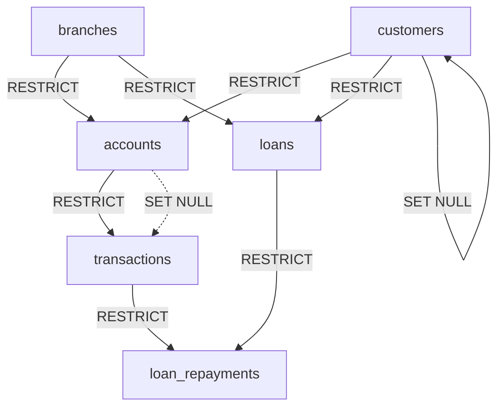

# 🏛️ Relational Model & Integrity Constraints
> **SPPA Core Banking System (`sppa_bank_db`)**

---

## 1. Overview & Formal Notation

The relational model represents database state as a collection of relations (tables), where each relation consists of tuples (rows) and attributes (columns).

### Formal Relational Schema Definitions

* $\text{BRANCHES}(\underline{\text{branch\_id}}, \text{branch\_name}, \text{ifsc\_code}, \text{city}, \text{created\_at})$
* $\text{CUSTOMERS}(\underline{\text{customer\_id}}, \text{first\_name}, \text{last\_name}, \text{email}, \text{phone}, \text{pan\_number}, \text{kyc\_status}, \text{referred\_by}^*, \text{created\_at})$
* $\text{ACCOUNTS}(\underline{\text{account\_id}}, \text{account\_number}, \text{customer\_id}^*, \text{branch\_id}^*, \text{account\_type}, \text{balance}, \text{interest\_rate}, \text{status}, \text{opened\_at})$
* $\text{LOANS}(\underline{\text{loan\_id}}, \text{customer\_id}^*, \text{branch\_id}^*, \text{loan\_type}, \text{principal\_amount}, \text{interest\_rate}, \text{tenure\_months}, \text{outstanding\_balance}, \text{application\_status}, \text{applied\_at})$
* $\text{TRANSACTIONS}(\underline{\text{transaction\_id}}, \text{reference\_no}, \text{account\_id}^*, \text{related\_account\_id}^*, \text{txn\_type}, \text{amount}, \text{balance\_after}, \text{description}, \text{txn\_timestamp})$
* $\text{LOAN\_REPAYMENTS}(\underline{\text{repayment\_id}}, \text{loan\_id}^*, \text{transaction\_id}^*, \text{emi\_amount}, \text{payment\_date})$

*Note: Underlined attributes represent Primary Keys ($\underline{\text{PK}}$); starred attributes represent Foreign Keys ($^*$).*

---

## 2. Integrity Constraint Specifications

Integrity constraints guard the database against loss of consistency, illegal balance modifications, or orphaned child records.

### 2.1 Entity Integrity
Every relation has a primary key that uniquely identifies each tuple, and no primary key attribute can be `NULL`.
* Guaranteed via `AUTO_INCREMENT PRIMARY KEY` on all 6 tables (`branch_id`, `customer_id`, `account_id`, `loan_id`, `transaction_id`, `repayment_id`).

### 2.2 Domain Constraints
Attributes are restricted to well-defined physical and logical domains:

| Attribute | Table | Domain / Constraint | Description |
| :--- | :--- | :--- | :--- |
| `ifsc_code` | `branches` | `VARCHAR(11)` | Alphanumeric Indian Financial System Code. |
| `pan_number` | `customers` | `VARCHAR(10)` | Indian Permanent Account Number format. |
| `kyc_status` | `customers` | `ENUM('PENDING', 'VERIFIED', 'REJECTED')` | Finite set of allowed KYC lifecycle states. |
| `account_type` | `accounts` | `ENUM('SAVINGS', 'CURRENT', 'FD')` | Permitted deposit/current product types. |
| `status` | `accounts` | `ENUM('ACTIVE', 'FROZEN', 'CLOSED')` | Operational lifecycle status. |
| `balance` | `accounts` | `DECIMAL(15,2)` | 15 digits of monetary precision (2 decimal places). |
| `loan_type` | `loans` | `ENUM('HOME', 'PERSONAL', 'EDUCATION', 'VEHICLE')` | Permitted credit categories. |
| `application_status` | `loans` | `ENUM('APPLIED', 'APPROVED', 'REJECTED', 'CLOSED')` | Approval status. |
| `txn_type` | `transactions` | `ENUM('DEPOSIT', 'WITHDRAWAL', 'TRANSFER_IN', 'TRANSFER_OUT', 'LOAN_EMI')` | Ledger transaction categories. |

---

### 2.3 Referential Integrity & Cascade Rules

Foreign keys enforce valid relationships between tables with deliberate deletion policies:



| Constraint Name | Child Table | Parent Table | On Delete Action | Business Rationale |
| :--- | :--- | :--- | :---: | :--- |
| `fk_customer_referral` | `customers` | `customers(customer_id)` | `SET NULL` | If a referrer customer leaves, existing customers must not be deleted; referral is set to `NULL`. |
| `fk_account_customer` | `accounts` | `customers(customer_id)` | `RESTRICT` | A customer with open accounts cannot be deleted. Accounts must be closed first. |
| `fk_account_branch` | `accounts` | `branches(branch_id)` | `RESTRICT` | A branch with active accounts cannot be deleted without transferring accounts first. |
| `fk_loan_customer` | `loans` | `customers(customer_id)` | `RESTRICT` | A customer with loan contracts cannot be deleted. |
| `fk_loan_branch` | `loans` | `branches(branch_id)` | `RESTRICT` | A branch with active loan books cannot be dropped. |
| `fk_txn_account` | `transactions` | `accounts(account_id)` | `RESTRICT` | Financial transactions form an immutable audit ledger; parent accounts cannot be removed. |
| `fk_txn_related_account` | `transactions` | `accounts(account_id)` | `SET NULL` | Counterparty reference is preserved if possible or set to `NULL` if counterparty account purged. |
| `fk_repay_loan` | `loan_repayments`| `loans(loan_id)` | `RESTRICT` | Repayment records cannot exist orphaned from their loan contract. |
| `fk_repay_txn` | `loan_repayments`| `transactions(transaction_id)` | `RESTRICT` | Every loan repayment must link permanently to an immutable transaction ledger entry. |

---

### 2.4 Semantic & Enterprise Check Constraints

Business logic constraints enforced at the database kernel level:

```sql
-- 1. Balance must never become negative
CONSTRAINT chk_positive_balance CHECK (balance >= 0.00);

-- 2. Transaction amounts must be strictly positive
CONSTRAINT chk_txn_amount CHECK (amount > 0);

-- 3. Loan principal must be greater than zero
CONSTRAINT chk_loan_principal CHECK (principal_amount > 0);

-- 4. Loan tenure must be at least one month
CONSTRAINT chk_loan_tenure CHECK (tenure_months > 0);

-- 5. Outstanding debt cannot be negative
CONSTRAINT chk_outstanding CHECK (outstanding_balance >= 0);

-- 6. EMI installment must be positive
CONSTRAINT chk_emi_positive CHECK (emi_amount > 0);
```

---

## 3. Relational Algebra Mapping

Key SQL operations in `sppa_bank_db` mapped to theoretical relational algebra expressions:

### 3.1 Selection ($\sigma$) and Projection ($\pi$)
* **Business Query:** Retrieve active Savings account numbers and balances.
$$\pi_{\text{account\_number}, \text{balance}} (\sigma_{\text{account\_type} = \text{'SAVINGS'} \land \text{status} = \text{'ACTIVE'}} (\text{ACCOUNTS}))$$

### 3.2 Natural Join / Equi-Join ($\bowtie$)
* **Business Query:** Retrieve transaction statement with customer names and branch details.
$$\text{TRANSACTIONS} \bowtie_{\text{account\_id}} \text{ACCOUNTS} \bowtie_{\text{customer\_id}} \text{CUSTOMERS} \bowtie_{\text{branch\_id}} \text{BRANCHES}$$

### 3.3 Set Difference ($-$)
* **Business Query:** Customers who have a bank account but have never taken a loan.
$$\pi_{\text{customer\_id}}(\text{ACCOUNTS}) - \pi_{\text{customer\_id}}(\text{LOANS})$$

### 3.4 Left Outer Join ($\leftouterjoin$)
* **Business Query:** Display all customers and their account balances, retaining customers with zero accounts.
$$\text{CUSTOMERS} \leftouterjoin_{\text{CUSTOMERS.customer\_id} = \text{ACCOUNTS.customer\_id}} \text{ACCOUNTS}$$
